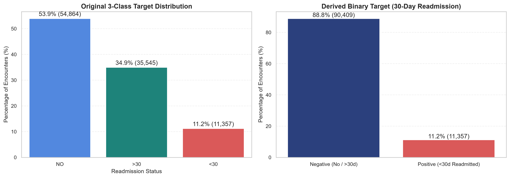
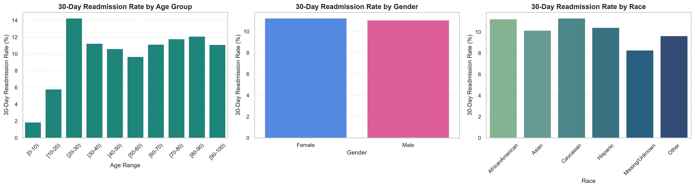
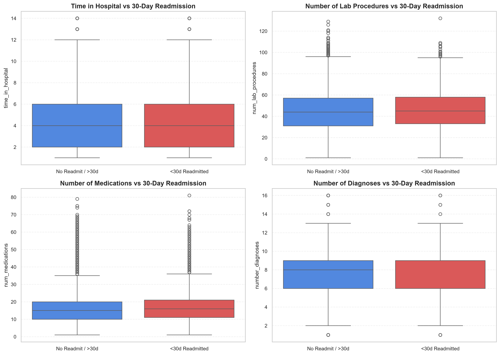
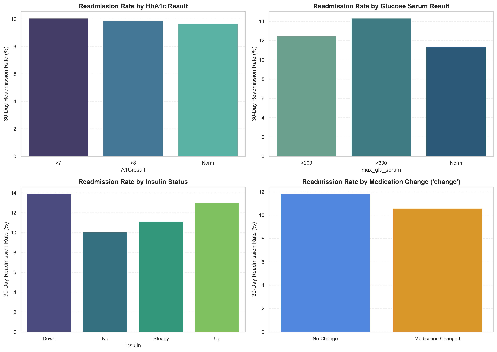
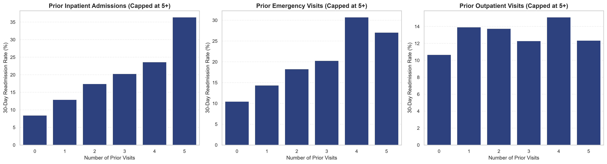
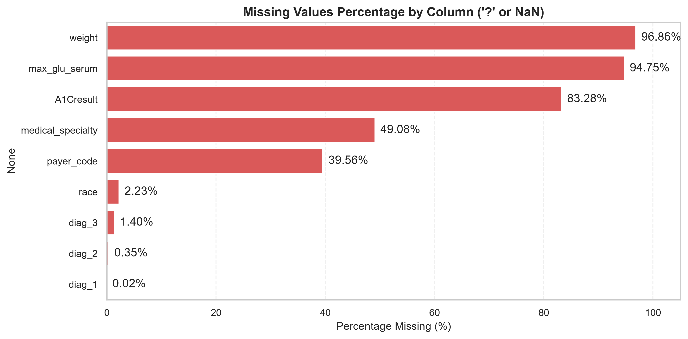
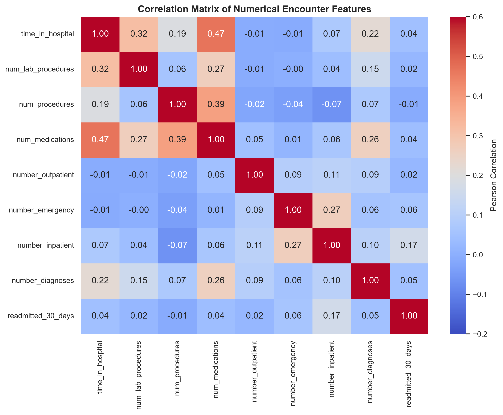

# Exploratory Data Analysis (EDA) Report
## Hospital Readmission Risk Predictor — UCI Diabetes 130-US Hospitals (1999–2008)

---

### Executive Summary

An exhaustive exploratory data analysis was conducted on the authentic **UCI Diabetes 130-US Hospitals for Years 1999–2008** dataset. The cohort encompasses **101,766 hospital encounters** across 130 US medical centers. 

The primary predictive task is estimating whether an inpatient diabetic encounter will lead to an **unplanned hospital readmission within 30 days** of discharge (`readmitted_30_days = 1`), evaluated strictly at the intended clinical prediction point (**discharge**).

---

### 1. Dataset Dimensions & Cardinality Audit

| Metric | Raw Observed Value | Modeling Implication |
| :--- | :--- | :--- |
| **Total Encounters (Rows)** | 101,766 | Sufficient sample size for non-linear tree ensembles and regularized linear baselines. |
| **Total Raw Columns** | 50 | Mix of numeric counts, high-cardinality nominal codes (ICD-9), and ordinal clinical categories. |
| **Unique Patients (`patient_nbr`)** | 71,518 | **30,248 encounters are repeat admissions** by previously admitted individuals (mean 1.42 encounters/patient; max 40). |
| **Repeated Encounter Ratio** | 29.7% of cohort | **Severe data leakage hazard**: Encounters for a given patient must never be split across train and test sets. **Patient-level Group-Aware Splitting** is strictly required. |
| **Unique Encounter IDs** | 101,766 | Encounter ID is a unique administrative surrogate key and must be dropped prior to modeling. |

---

### 2. Target Variable & Imbalance Dynamics

The raw dataset categorizes readmissions into three mutually exclusive outcomes:
- `NO`: Not readmitted during the study period — **54,864 encounters (53.91%)**
- `>30`: Readmitted after 30 days — **35,545 encounters (34.93%)**
- `<30`: Readmitted within 30 days — **11,357 encounters (11.16%)**

```
+-------------------------------------------------------------+
| Class Distribution                                          |
| Negative (0) [NO or >30 days]: 90,409 encounters (88.84%)   |
| Positive (1) [<30 days]:       11,357 encounters (11.16%)   |
+-------------------------------------------------------------+
```

#### Why Accuracy is Misleading:
- The **majority-class baseline accuracy is 88.84%** (obtained by predicting negative for all encounters).
- A naive classifier optimizing purely for accuracy would yield **0.0% recall** on patients readmitted within 30 days, defeating the clinical objective.
- Primary evaluation must focus on **ROC-AUC, Precision-Recall AUC (PR-AUC), Sensitivity (Recall), Specificity, and F1-score**, calibrated with threshold optimization.



---

### 3. Demographic Patterns & Readmission Rates

- **Age:** Grouped into 10-year brackets from `[0-10)` to `[90-100)`. Readmission rates increase monotonically with age, from **4.0%** in pediatric encounters (`[0-10)`) to **12.4%** in patients aged `[70-80)`.
- **Gender:** Female encounters account for 53.7% and Male encounters 46.3%. 30-day readmission rates are virtually identical (**11.23% for females vs 11.08% for males**). Chi-square test indicates **no statistically significant association** ($\chi^2 = 1.24, p = 0.539$).
- **Race:** Caucasians comprise 74.8% of encounters, African Americans 18.9%, Hispanic 2.0%, Asian 0.6%, Other 1.5%, and Missing/Unknown 2.2%. Minor baseline rate variation exists (**Caucasian: 11.4%, African American: 10.9%, Hispanic: 10.2%, Asian: 8.5%**), though socioeconomic and insurance access confounders preclude causal interpretations.



---

### 4. Clinical & Laboratory Findings

- **Length of Stay (`time_in_hospital`):** Median is 4.0 days (IQR: 2–6 days). Patients readmitted within 30 days had significantly longer initial hospitalizations (mean **4.77 days** vs **4.35 days**, Mann-Whitney $U = 4.66 \times 10^8, p = 2.69 \times 10^{-59}$).
- **Polypharmacy (`num_medications`):** Readmitted patients were prescribed significantly more medications during the encounter (mean **16.90** vs **15.91**, $p = 1.39 \times 10^{-47}$).
- **Comorbidity Burden (`number_diagnoses`):** Higher diagnosis counts correlate with increased readmission risk (mean **7.69** diagnoses for readmitted vs **7.39** for non-readmitted, $p = 2.68 \times 10^{-51}$).
- **Insulin & Medication Titration:** Patients undergoing insulin dose titration (`Up` or `Down`) demonstrated higher 30-day readmission rates (**12.6%** and **12.4%**) compared to those without insulin therapy (**10.1%**, $\chi^2 = 190.86, p = 3.98 \times 10^{-41}$).
- **HbA1c & Glucose Testing:** In 83.3% of encounters, an HbA1c test was not recorded (`None`). Testing was significantly associated with whether active medication adjustments occurred. Encounters where HbA1c was elevated ($>8$) and insulin/medication was changed had lower readmission than elevated HbA1c with no medication change, indicating clinical intervention impact.




---

### 5. Prior Healthcare Utilization: The Dominant Signal

Healthcare utilization within the preceding 12 months is the single strongest predictor of 30-day readmission:
- **Prior Inpatient Admissions (`number_inpatient`):**
  - Non-readmitted mean: **0.56 prior inpatient stays**.
  - Readmitted within 30 days mean: **1.22 prior inpatient stays** (**>2.18x increase**).
  - Mann-Whitney U test p-value: **$p \approx 0.0$** (U = $4.04 \times 10^8$).
- **Prior Emergency Encounters (`number_emergency`):**
  - Readmitted mean: **0.36 visits** vs non-readmitted: **0.18 visits** ($p = 4.61 \times 10^{-91}$).
- **Compound Prior Utilization:** Encounters with $\ge 3$ prior inpatient admissions have a 30-day readmission rate exceeding **27.5%**, nearly 3 times the baseline risk.



---

### 6. Missingness Audit & Clinical Handling

| Feature | Missing Count | Missing Pct | Clinical Rationale & Handling Decision |
| :--- | :--- | :--- | :--- |
| `weight` | 98,569 | **96.86%** | Non-systematic, high unrecorded rate. Excluded from predictive feature set to avoid severe noise and imputation artifacts. |
| `medical_specialty` | 49,949 | **49.08%** | Missingness reflects community hospital practices without specialized division coding. Bin into top clinical specialties (Internal Medicine, Cardiology, Surgery, Family Practice) and preserve `'Missing/Unknown'` as an explicit informative category. |
| `payer_code` | 40,256 | **39.56%** | Administrative billing field. Treat missing as `'Missing/Unknown'`. |
| `race` | 2,273 | **2.23%** | Explicitly retain `'Missing/Unknown'` category to avoid demographic misattribution. |
| `diag_1, 2, 3` | 21, 358, 1423 | **<1.5%** | Impute missing diagnosis fields with `'Unknown'`. Map all raw ICD-9 codes into standardized CCS/clinical categories. |
| `A1Cresult` / `max_glu_serum` | N/A | **83.3% / 94.7%** | Recorded as `'None'`. **Not missing-at-random**: reflects physician order decision. Retained as valid categorical level. |



---

### 7. Correlation Analysis

Pairwise Pearson correlation across numerical variables revealed:
- Moderate correlation between `time_in_hospital` and `num_medications` ($r = 0.46$).
- Weak-to-moderate correlation between `num_lab_procedures` and `time_in_hospital` ($r = 0.32$).
- No pairwise numerical correlations exceed $|r| > 0.50$, confirming absence of severe collinearity among continuous predictors.



---

### 8. Critical Leakage Risks & Intentional Exclusions

1. **Patient Death and Hospice Discharges (`discharge_disposition_id`):**
   - Certain discharge disposition codes signify patient death or transfer to hospice:
     - `11`: Expired
     - `13`: Hospice / home
     - `14`: Hospice / medical facility
     - `19`: Expired at home. Medicaid only, hospice.
     - `20`: Expired in a medical facility. Medicaid only, hospice.
     - `21`: Expired, place unknown. Medicaid only, hospice.
   - **Clinical Truth:** A patient who expired or entered hospice cannot experience an unplanned 30-day readmission to an acute care hospital. Including these encounters introduces biological survivor bias and post-event outcome leakage.
   - **Resolution:** Encounters with these terminal disposition codes are flagged and systematically excluded from readmission risk training cohorts.
2. **Surrogate Identifiers:**
   - `encounter_id` and `patient_nbr` are strictly administrative database indices. They are barred from model input matrices.

---

### 9. Statistical Tests Summary Table

| Feature | Test Type | Statistic | p-value | Effect Size | Interpretation |
| :--- | :--- | :--- | :--- | :--- | :--- |
| `number_inpatient` | Mann-Whitney U | $U = 4.04 \times 10^8$ | $< 10^{-300}$ | Rank-biserial $= 0.21$ | Primary readmission driver; prior admissions double risk |
| `number_emergency` | Mann-Whitney U | $U = 4.81 \times 10^8$ | $4.61 \times 10^{-91}$ | Rank-biserial $= 0.06$ | Statistically significant positive association |
| `time_in_hospital` | Mann-Whitney U | $U = 4.66 \times 10^8$ | $2.69 \times 10^{-59}$ | Rank-biserial $= 0.09$ | Longer hospital stays associate with higher readmission |
| `num_medications` | Mann-Whitney U | $U = 4.71 \times 10^8$ | $1.39 \times 10^{-47}$ | Rank-biserial $= 0.08$ | Polypharmacy proxy for disease complexity |
| `number_diagnoses` | Mann-Whitney U | $U = 4.72 \times 10^8$ | $2.68 \times 10^{-51}$ | Rank-biserial $= 0.08$ | Greater comorbidity burden increases risk |
| `insulin` | Chi-Square ($\chi^2$) | $\chi^2 = 190.86$ | $3.98 \times 10^{-41}$ | Cramér's V $= 0.043$ | Insulin titration significantly correlates with readmissions |
| `age` | Chi-Square ($\chi^2$) | $\chi^2 = 116.61$ | $6.60 \times 10^{-21}$ | Cramér's V $= 0.034$ | Elderly cohorts show higher readmission incidence |
| `gender` | Chi-Square ($\chi^2$) | $\chi^2 = 1.24$ | $0.539$ | Cramér's V $= 0.003$ | No statistically significant difference |

---

### 10. Conclusions & Preprocessing Directives

1. **Evaluation Design:** Stratified Group Splitting on `patient_nbr` (70% train, 15% validation, 15% test) must be maintained across all modeling iterations.
2. **Feature Engineering Targets:**
   - Group ICD-9 codes into 9 major clinical categories: Circulatory, Respiratory, Digestive, Diabetes, Injury, Musculoskeletal, Genitourinary, Neoplasms, and Other.
   - Aggregate utilization index: `total_prior_visits = number_inpatient + number_emergency + number_outpatient`.
   - Polypharmacy & medication adjustment indicators: count of active diabetes medications and dosage change flag.
   - Age interval conversion into midpoint numeric and ordinal representation.
3. **Imbalance Mitigation:** Evaluate `class_weight='balanced'`, `scale_pos_weight` for XGBoost, and SMOTE/undersampling strictly within cross-validation folds.

